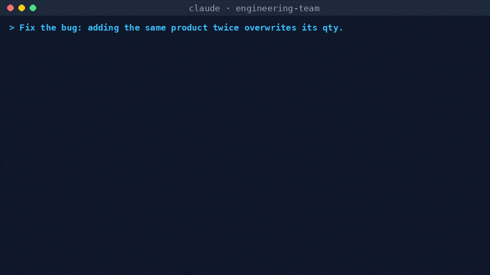
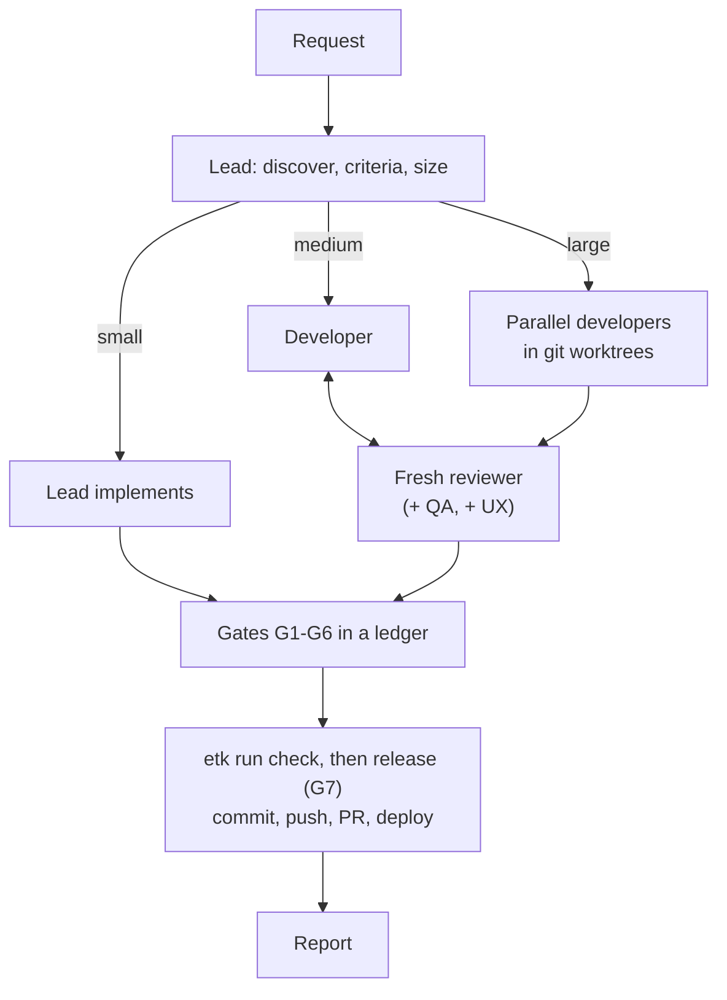

<div align="center">

# Engineering Team Kit

A Claude Code plugin that implements a change, has it reviewed independently, tests until it really passes, and ships only as far as you allow.

[Quick start](#quick-start) · [Commands](#commands) · [How it works](#how-it-works) · [Documentation](#documentation) · [Contributing](#contributing)

[](https://github.com/hoanganhnvnb/engineering-team-kit/actions/workflows/ci.yml)
[](https://github.com/hoanganhnvnb/engineering-team-kit/releases)
[](LICENSE)


</div>

## Overview

Asking a coding agent to "fix it and push" gets you code that was reviewed by the same
context that wrote it, tests that were assumed to pass, and a push you didn't scope.
Engineering Team Kit makes the main Claude session a **Lead** that runs a small team:
a developer, an independent reviewer, and QA and UX reviewers when they're worth the cost.

- **Independent review.** The reviewer sees the diff and the acceptance criteria, never
  the developer's summary, and can't edit files.
- **Evidence for every "passed".** Each gate needs written evidence, and the test and
  regression gates need a recorded command and exit code. A PASS without it fails
  `etk run check`.
- **Shipping on your terms.** Commit and push follow your own workflow profile. Merge
  and deploy need your words in the conversation, and production must be named.
- **Your project's rules win.** CLAUDE.md, rules, skills and CI come first.

It is built for solo developers and small teams working in git repositories.

## Quick start

Requirements: Claude Code with plugin support (built and tested on 2.1.329), `git` (SVN
gets commits only), and Python 3.12+ (found automatically; see [docs/install.md](docs/install.md) if it isn't).

```bash
claude plugin marketplace add hoanganhnvnb/engineering-team-kit
claude plugin install engineering-team@engineering-team-kit
```

Restart Claude Code, open a project and run `/engineering-team:init` once to confirm how
you commit, push, merge and deploy. Then ask for something:

```text
add CSV export to the orders report; open a PR once review passes
```

`init` detects your git host, branches and commit style, asks only what it can't detect
(PR or direct merge, how you deploy), and saves the answers to a profile outside the
repository. If you skip it, the first run asks the same questions midway.



## Commands

You can also just ask; Claude starts `team` for build, fix, ship and deploy requests.

| Command | What it does |
|---|---|
| `/engineering-team:init [reset]` | Once per project: detect, then ask only what is missing about commit, push, PR or merge and deploy; save it to your profile outside the repo |
| `/engineering-team:team <task>` | Implement, review, test and fix until it passes, then commit, push, PR and deploy as you allow |
| `/engineering-team:build <feature>` | Feature loop up to the gates and a report |
| `/engineering-team:fix <bug>` | Failing test first, root-cause fix, no regressions |
| `/engineering-team:review [ref\|PR\|path] [--fix]` | Independent read-only review; `--fix` runs the fix loop |
| `/engineering-team:test [scope\|regression]` | QA pass: real suites, edge cases, new vs pre-existing failures |
| `/engineering-team:improve-ui <screen>` | Before/after UX review in a browser, then fix and re-verify |
| `/engineering-team:retro [last N]` | Recurring findings and the checks worth adding |
| `/engineering-team:readme [focus]` | Audit and redesign the README against the real repository |

Only `team` can be started by Claude on its own; the others, `init` included, run when you type them.

## How it works



- **Sizing.** One or two obvious files: the Lead does it. Real logic or anything
  security-sensitive: developer plus independent reviewer. Several independent parts: a
  contract first, then parallel developers. ([routing](workflows/routing.md))
- **Review loop.** Findings go to a fresh developer and a fresh reviewer verifies the
  fix, for up to `max_cycles` rounds (3 by default), then it escalates to you.
  ([review loop](workflows/review-loop.md))
- **Gates.** Requirements, review, tests, regression, UI and security, each PASS, FAIL,
  BLOCKED, NOT_RUN or NOT_APPLICABLE with evidence. ([gates](quality/gates.md))
- **Conventions.** Agents follow a small [conventions pack](docs/conventions.md) where
  your project is silent.
- **Seatbelt, not a sandbox.** A hook keeps the plugin's own subagents from pushing,
  deploying, rewriting history or writing secrets. ([limitations](docs/limitations.md))

## Configuration

Nothing is required. To pin commands, invariants, the UI URL or protected paths, add
`.claude/engineering-team.json` to the project. See
[docs/configuration.md](docs/configuration.md) and [the template](templates/engineering-team.json).
Your own commit, push and deploy habits live in the per-developer profile described in
[docs/workflow.md](docs/workflow.md).

## FAQ

**Will it push to my main branch?** Only if your profile is trunk-based with push set to
`auto`, or you asked. It never force-pushes or skips hooks.

**Without GitHub?** GitLab uses `glab`, Bitbucket gets a PR link, SVN gets commits only.
With no VCS the release steps are skipped.

**What does it cost?** A small fix took about a minute and under a dollar in the
recorded runs; see [docs/validation.md](docs/validation.md).

## Documentation

| | |
|---|---|
| [Install and upgrade](docs/install.md) | Pinning, team setup, rollback, missing Python |
| [Workflow](docs/workflow.md) | Phases, the profile, who may do what |
| [Usage](docs/usage.md) | Examples for each command |
| [Configuration](docs/configuration.md) | Project config reference |
| [Architecture](docs/architecture.md) | Components and design decisions |
| [Validation](docs/validation.md) | End-to-end runs and results |
| [Limitations](docs/limitations.md) | What it can't do, and the guard's limits |

## Repository layout

| Path | Contents |
|---|---|
| `skills/` | The slash commands the Lead runs |
| `agents/` | Subagents: developer, code-reviewer, qa-engineer, ux-reviewer, scout, tech-writer |
| `workflows/`, `quality/`, `conventions/` | Process, gates and conventions read on demand |
| `hooks/`, `scripts/` | The guard hook, the run ledger, the profile and the launchers |
| `tests/`, [`evals/`](evals/README.md) | Unit and structure tests; model-graded evals |

## Contributing

```bash
git clone https://github.com/hoanganhnvnb/engineering-team-kit && cd engineering-team-kit
bash scripts/selftest.sh        # manifests + unit and structure tests
claude --plugin-dir .           # try it
```

See [CONTRIBUTING.md](CONTRIBUTING.md). Report security issues privately
([SECURITY.md](SECURITY.md)).

## License

[MIT](LICENSE)
